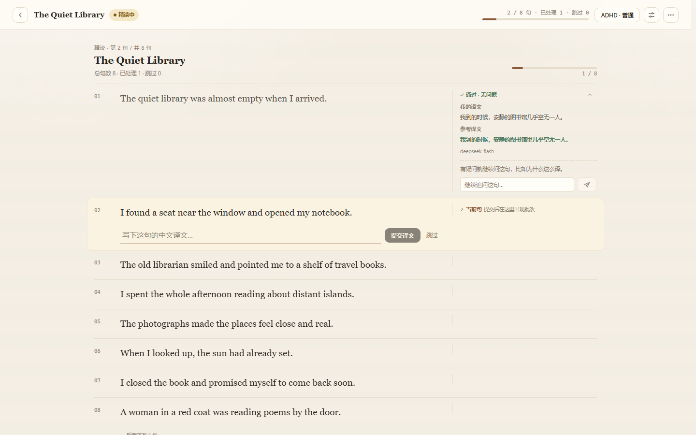
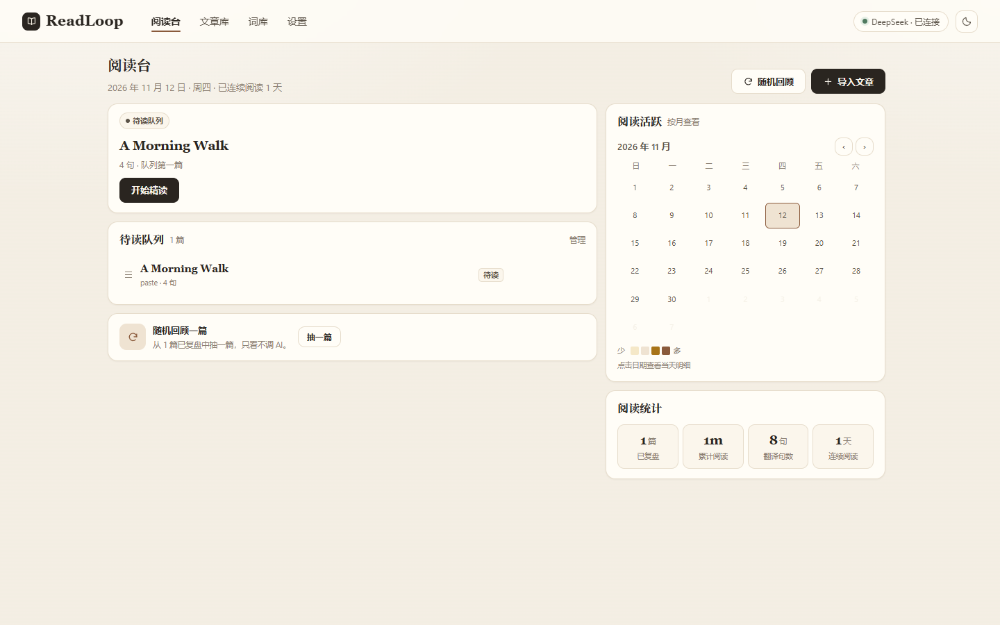
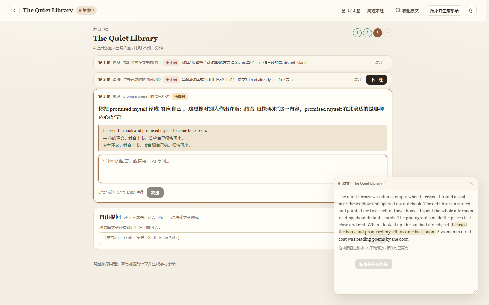
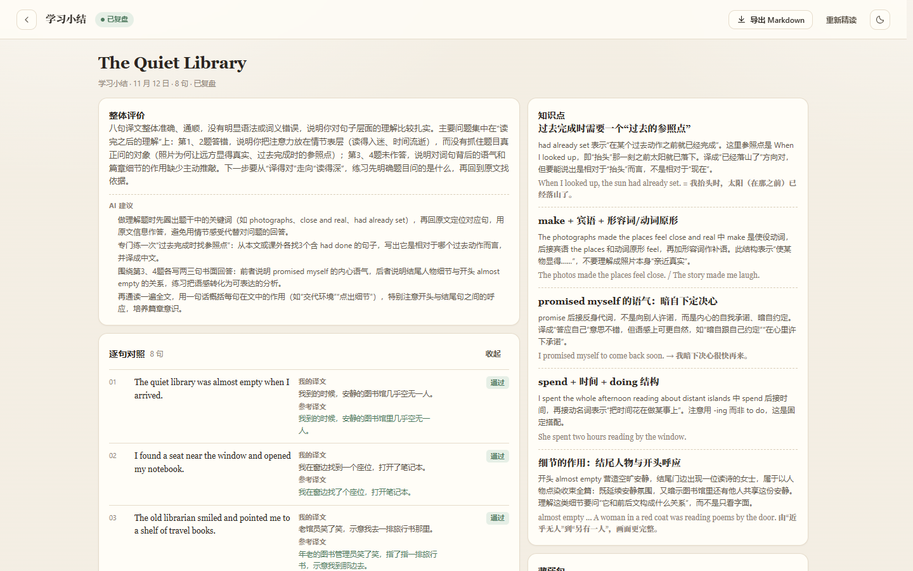
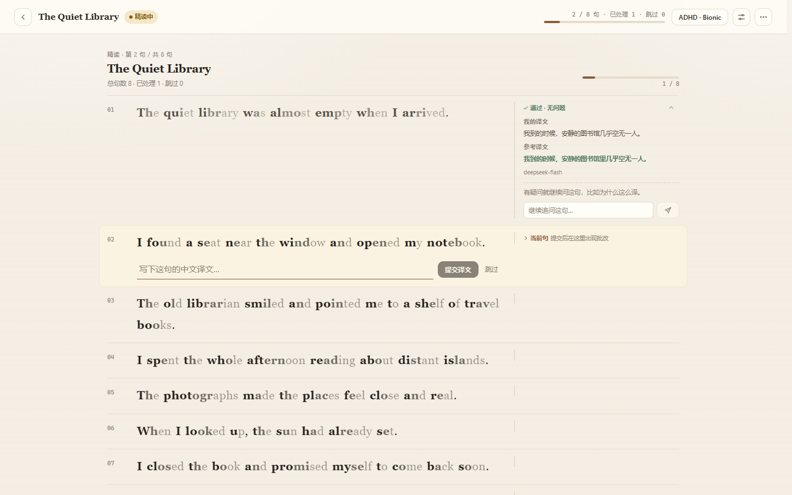
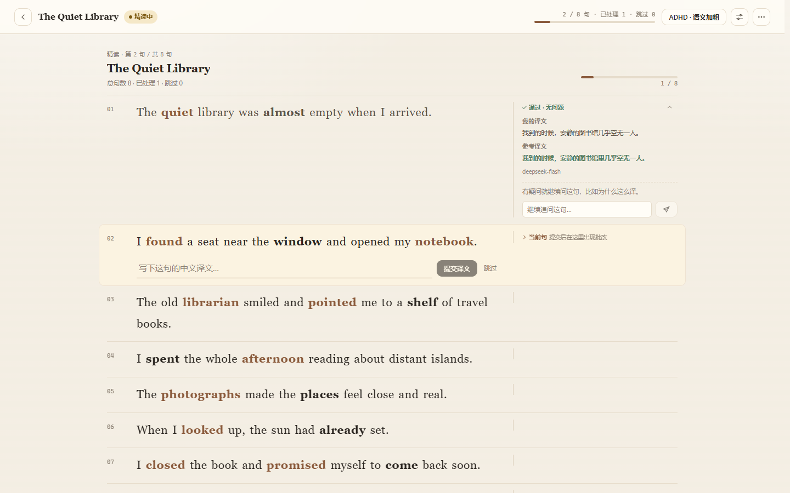
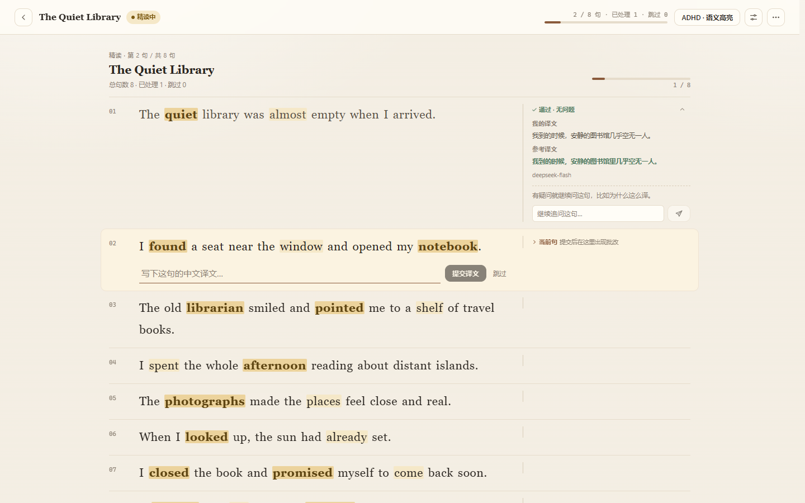
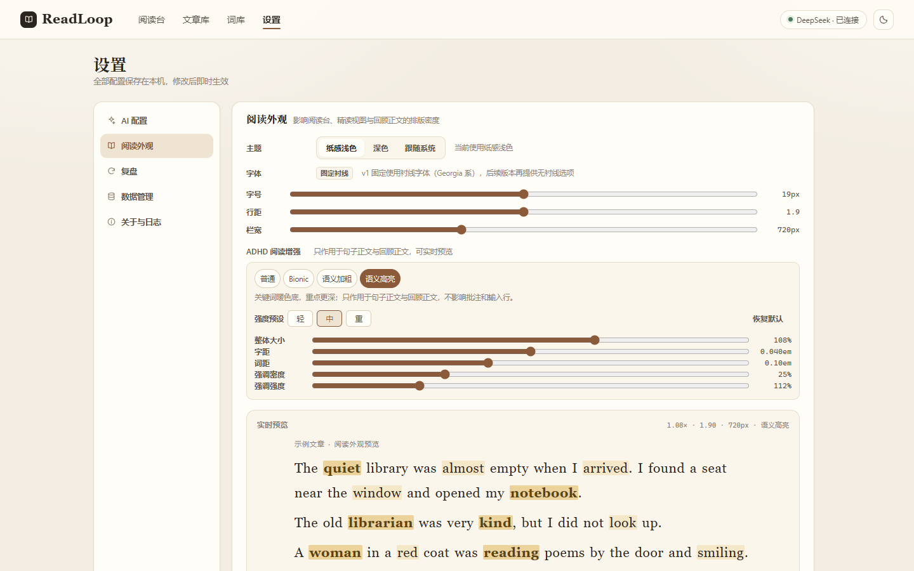

# ReadLoop

> 阅读优先的本地英语精读工作台：逐句自己译 → AI 批改 → 句内追问 → 复盘问答 → 结构化小结。没有单词复习，没有云端账号。




## 这是什么

ReadLoop 解决的是「读了很多英文，但没真正读进去」的问题。

它把一篇文章拆成句子，要求你先自己写出中文译文，再由 AI 逐句批改：指出误译/漏译/理解偏差、给出参考译文，你可以就这一句继续追问。读完进入复盘：AI 根据你的**真实译文**出开放题（理解/语法/翻译），逐题作答并点评，可自由提问；最后生成学习小结（问题统计、知识点、逐句对照、薄弱句、笔记），支持导出 Markdown，也可以过段时间随机抽一篇回顾。

- **阅读优先**：核心循环是「读—译—被纠正—复盘」，不做单词卡片和间隔复习。
- **本地优先**：单机 HTTP 服务 + 浏览器界面 + Windows 托盘；数据全在本机 SQLite，无云端存储、无遥测。
- **模型自带**：填任意 OpenAI 兼容接口（DeepSeek / OpenAI / 本地网关均可），API Key 只存在本机。
- **轻量**：无 Electron、无本地大模型；托盘是 .NET Framework WinForms，服务是 Node。

## 界面

| 阅读台 | 精读（B 句行稿纸） |
|---|---|
|  |  |

| 复盘（C 回合卡片 + 原文浮窗） | 学习小结 |
|---|---|
|  |  |

## ADHD 阅读增强

内置四种阅读模式，参数可调并实时预览，只作用于句子正文，不影响批注和输入：

| Bionic（lead 加粗 + mid/tail 透明度渐变） | 语义加粗（选词 + 加强层） | 语义高亮 |
|---|---|---|
|  |  |  |

在 **设置 → 阅读外观** 里可以调整体大小、字距、词距、强调密度/强度、Bionic 比例，或一键切换轻/中/重预设：



## 功能一览

- **导入**：粘贴正文，或导入 `.txt` / `.md`；Markdown 按标题拆成多篇、可勾选批量导入，自动清洗任务列表标记（`- [x] 已读`）。
- **精读**：逐句行内输入译文（Enter 提交）；右侧页边批注显示问题与参考译文；支持句内追问（流式）、折叠/展开、跳过、断点续读。
- **复盘**：按文章长度自动出 4–6 道开放题（理解/语法/翻译），逐题作答与点评；原文浮窗可拖拽缩放；自由提问支持 Markdown（含表格）。
- **小结**：整体评价、问题统计、知识点、逐句对照、薄弱句、建议、笔记；可导出 Markdown、重新精读。
- **回顾**：从已复盘文章中随机抽一篇只读回看，不调用 AI。
- **统计**：阅读时长、翻译句数、连续天数与月度活跃日历。
- **词库**：划词查词（ECDICT，本地）、收藏、CSV 导出。
- **隐私与数据**：数据在 `%APPDATA%\readloop`，导出备份、AI 用量统计、日志查看。

## 快速开始（Windows）

1. 安装 [Node.js 20.19+](https://nodejs.org/)（推荐 LTS）。
2. 下载 / clone 本仓库到本地。
3. 准备词典（可选但推荐）：从 [ECDICT](https://github.com/skywind3000/ECDICT) 下载 `stardict.db`（约 850MB，MIT 协议），放到项目根目录，或运行 setup 时选择文件。
4. 双击 **`setup.bat`**。它会安装依赖、构建前端、编译托盘、复制并校验词典、创建桌面快捷方式。
5. 从桌面快捷方式（或 `tray\ReadLoopTray.exe`）启动，浏览器会自动打开 <http://127.0.0.1:5178/>。
6. 打开 **设置 → AI 配置**，填接口地址（如 `https://api.deepseek.com`）、API Key、模型，保存并「测试连接」。

> 没有词典也能运行，只是划词查词与词库功能不可用。
> 端口默认 5178，被占用时托盘会在 5178–5200 间自动顺延（配置 `%APPDATA%\readloop\tray.json`）。

## 使用流程

1. **导入**：文章库右上「导入文章」，粘贴或选择 `.md`/`.txt`；md 可勾选多篇。
2. **精读**：逐句写译文 → Enter 提交 → 看右侧批注，可继续追问；Enter/「下一句」推进。
3. **复盘**：全部句子处理后点「进入复盘」，逐题作答；随时可结束生成小结。
4. **回看**：阅读台「随机回顾」抽一篇已复盘文章，只读回看，不烧 token。

## 技术栈

| 层 | 选型 |
|---|---|
| 服务端 | Node.js 20+、Express 5、better-sqlite3（WAL）、Zod |
| 前端 | Vue 3、Vue Router、Vite；无 UI 框架，自建设计令牌 |
| AI | 任意 OpenAI 兼容 `/v1/chat/completions`；JSON 模式 + SSE 流式；失败降级不阻塞阅读 |
| 桌面 | .NET Framework 4.8 WinForms 托盘（`csc.exe` 编译，无需安装 SDK） |
| 词典 | ECDICT `stardict.db`（SQLite，只读） |
| 测试 | `node:test`（单元 + 集成）、Playwright（本机 Edge + Mock AI） |

架构与数据流详见 [docs/ARCHITECTURE.md](docs/ARCHITECTURE.md)。

## 开发

```bat
npm ci
npm run dev          :: 服务 5178 + Vite 5173（/api 代理到 5178）
npm run build        :: 构建前端到 server/public
npm start            :: 仅启动服务
npm test             :: 单元 + 集成（node:test）
npm run lint
npx playwright test  :: E2E，需要本机 Edge + dev-data/e2e/stardict.db
npm run mock:ai      :: 本地 Mock AI（5179）
npm run tray:build   :: 重新编译托盘（需要 .NET Framework 的 csc.exe）
node tools/real-ai-check.mjs --run   :: 真实 AI 验收（会消耗少量 token）
```

E2E 的词典依赖：把 ECDICT 的 `stardict.db` 复制到 `dev-data/e2e/stardict.db`（已 gitignore）。CI 只跑 lint + 单元/集成 + 构建，不跑需要词典与 Edge 的 E2E。

## 数据与隐私

- 数据目录：`%APPDATA%\readloop`（可用 `READLOOP_DATA_DIR` 覆盖）。
  - `readloop.db`：文章、逐句记录、复盘、小结、词库、设置、AI 调用记录
  - `stardict.db`：ECDICT 词典（只读）
  - `backups/`：设置页导出的数据库备份
  - `logs/`：`tray.log` / `server.log`（5MB 轮转）
- API Key 只存本机 SQLite，界面上打码显示；日志、AI 调用记录不写入 Key，prompt 只保存 500 字预览。
- 文章内容只会发送到你自己配置的 AI 接口；项目没有遥测与第三方统计。
- 卸载：托盘退出 → 删除项目目录，按需删除 `%APPDATA%\readloop`。

## 已知限制（v1）

- 目前只针对 Windows；托盘依赖 .NET Framework。
- 复盘跳过的题不支持补做；跳过记为未完成。
- 词库仅支持 ECDICT 的 `stardict.db`。
- 跨设备同步 / 多用户 / 移动端不在 v1 范围。
- AI 任务失败会降级（批改可重试、通用题、简版小结），不会阻塞阅读，但降级时质量会下降。

## 致谢

- [ECDICT](https://github.com/skywind3000/ECDICT) 提供本地英汉词典
- [Vue](https://vuejs.org/)、[Express](https://expressjs.com/)、[better-sqlite3](https://github.com/WiseLibs/better-sqlite3)、[Vite](https://vitejs.dev/)、[Playwright](https://playwright.dev/) 等开源项目

## License

[MIT](LICENSE) © 2026 kokoroyi


